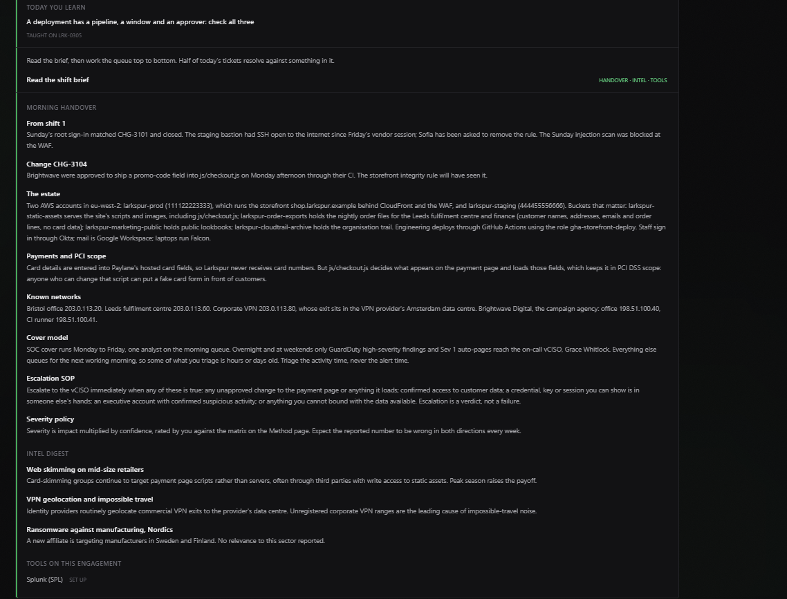
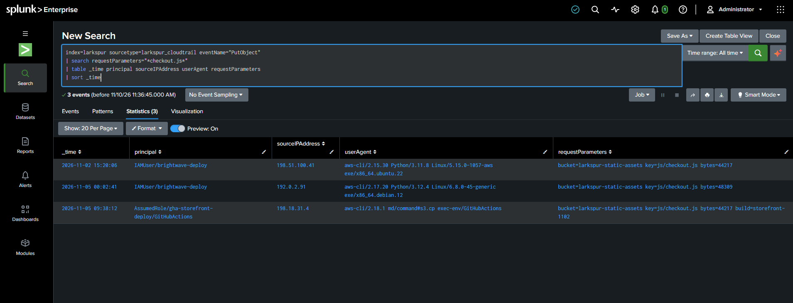
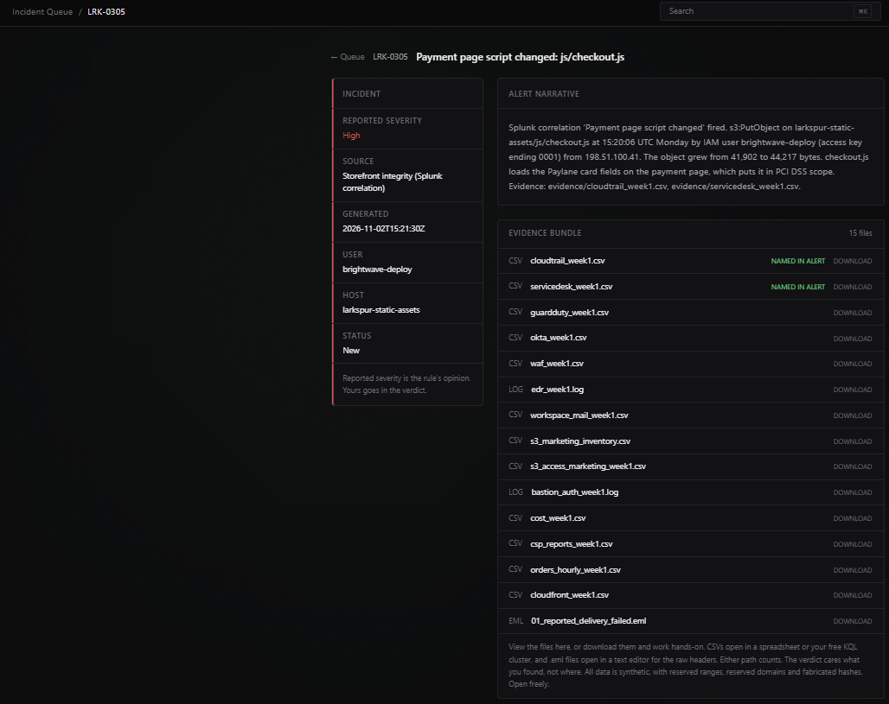
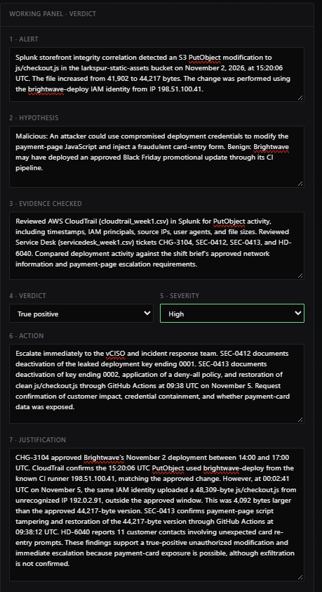
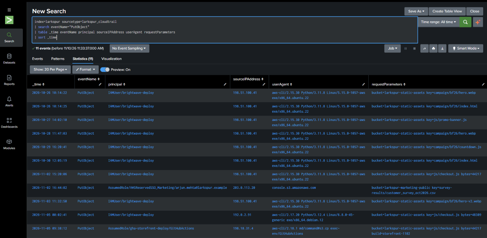
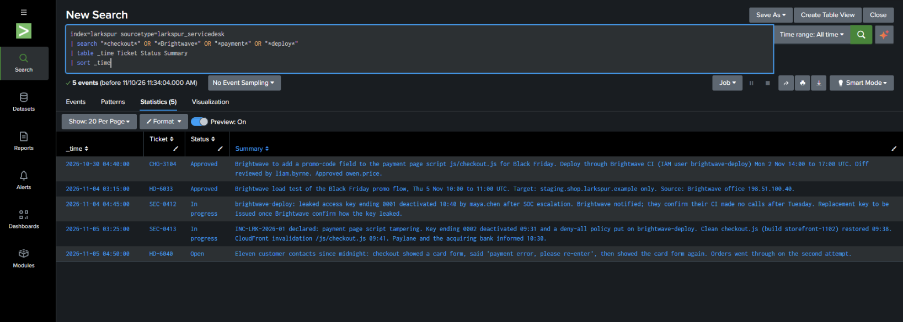

# SOC Incident Investigation — LRK-0305: Payment Page Script Tampering

**Environment:** Larkspur Home SOC training simulation  
**Tools:** Splunk Enterprise (SPL), AWS CloudTrail, Service Desk/change records  
**Classification:** True positive (investigation uncovered unauthorized tampering)  
**Severity:** High  
**Response:** Escalate to vCISO / incident response; verify containment and customer impact

> **Portfolio note:** This is a simulated training investigation. All organization names, addresses, and events are part of the lab scenario. The original alert was for an authorized November 2 deployment; the true-positive assessment refers to a separate November 5 modification discovered during triage.

## Executive summary

Splunk's storefront-integrity correlation alerted on a change to `js/checkout.js` in the `larkspur-static-assets` S3 bucket on November 2, 2026 at 15:20:06 UTC. The script affects the payment-page flow and loads hosted card-entry fields. The alert's change was consistent with approved Black Friday work (CHG-3104), but follow-up CloudTrail review revealed another write on November 5 from an unrecognized IP, outside the change window. Service Desk records corroborated a leaked deployment credential, confirmed script tampering, restoration of a clean file, and customer complaints about repeated card-entry prompts.

## Investigation questions

1. Was the alerted deployment authorized by a change ticket and executed within its approved window?
2. Did the write originate from the expected CI runner and tool fingerprint?
3. Were there later changes to the same payment-page script?
4. What containment, recovery, and customer-impact evidence exists?

## Evidence and timeline

| Timestamp (UTC) | Event | Evidence / interpretation |
|---|---|---|
| 2026-10-30 | CHG-3104 approved | Brightwave promo-code change to `js/checkout.js`; authorized deployment window Nov 2, 14:00–17:00 UTC; diff reviewed and approved |
| 2026-11-02 15:20:06 | S3 `PutObject` | `IAMUser/brightwave-deploy` from `198.51.100.41` (documented CI runner), AWS CLI 2.15.30; file size 44,217 bytes; consistent with approved change |
| 2026-11-05 00:02:41 | S3 `PutObject` | Same IAM identity from `192.0.2.91` (not in known Brightwave networks), AWS CLI 2.17.20; file size 48,309 bytes; outside approved window |
| 2026-11-05 09:38:12 | S3 `PutObject` | `AssumedRole/gha-storefront-deploy/GitHubActions` from `198.18.31.4`; clean 44,217-byte version restored; build `storefront-1102` |

The November 5 upload was **4,092 bytes larger** than the approved version. File-size changes alone cannot prove malicious content, but the change-window mismatch, unrecognized source, and Service Desk incident records support the tampering assessment.

### Corroborating tickets

- **CHG-3104:** Approved November 2 promotional deployment, including review and approvers.
- **SEC-0412:** Leaked Brightwave access key ending `0001` deactivated; Brightwave reported CI made no calls after Tuesday.
- **SEC-0413:** Payment-page script tampering incident declared; key ending `0002` deactivated, deny-all policy applied, clean checkout script restored at 09:38 UTC.
- **HD-6040:** Eleven customer contacts reported a card-entry form, then a payment error/re-entry prompt, before a successful second attempt.

## Splunk queries used

**Trace S3 writes to the checkout script**

```spl
index=larkspur sourcetype=larkspur_cloudtrail eventName="PutObject"
| search requestParameters="*checkout.js*"
| table _time principal sourceIPAddress userAgent requestParameters
| sort _time
```

**Review related change and support tickets**

```spl
index=larkspur sourcetype=larkspur_servicedesk
| search "*checkout*" OR "*Brightwave*" OR "*payment*" OR "*deploy*"
| table _time Ticket Status Summary
| sort _time
```

## Hypotheses

- **Benign:** Brightwave deployed the approved promotional update through its CI pipeline in the approved window.
- **Malicious:** Compromised deployment credentials were used to overwrite the payment-page script, potentially presenting customers with a fraudulent payment-card prompt.

Both possibilities appeared in the evidence: the November 2 write was consistent with the approved change, while the later November 5 write was linked to confirmed tampering.

## Verdict and response

**True Positive — High severity for the discovered November 5 tampering.** Escalation is warranted because the altered JavaScript controls the payment-page experience, and customer complaints suggest potential exposure. The supplied evidence **does not establish that card data was exfiltrated**.

Documented remediation included disabling compromised credentials, applying a deny-all policy, and restoring the clean script via GitHub Actions. Recommended follow-up: verify credential revocation and access logs, review the malicious script or preserved object version, establish the exposure window, assess affected customers and PCI obligations, and confirm monitoring for further writes.

## Screenshots

**Shift brief and known CI runner**



**CloudTrail PutObject investigation**



**Original incident alert and evidence bundle**



**Completed investigation verdict (True Positive / High)**



**Full CloudTrail S3 PutObject activity and deployment fingerprints**



**Service desk change approval, credential containment, incident response, and customer reports**



## Skills demonstrated

- Splunk SPL event filtering, field selection, and chronological analysis
- AWS CloudTrail S3 `PutObject` attribution using IAM principal, source IP, and user agent
- Change-management verification (approval, window, and CI origin)
- Cross-referencing SIEM evidence with incident and helpdesk records
- Evidence-based triage, severity selection, and escalation
